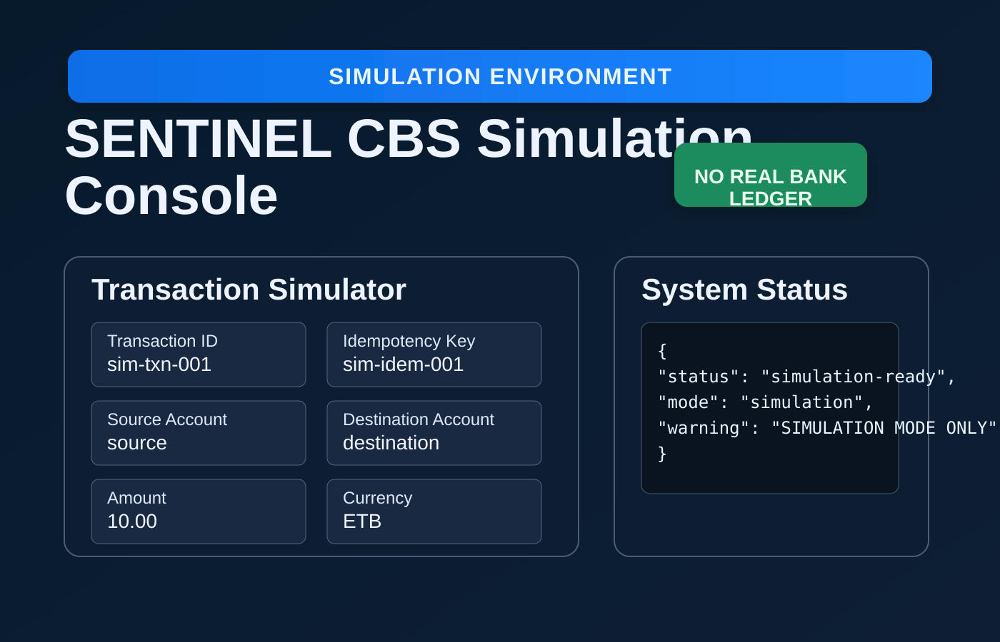
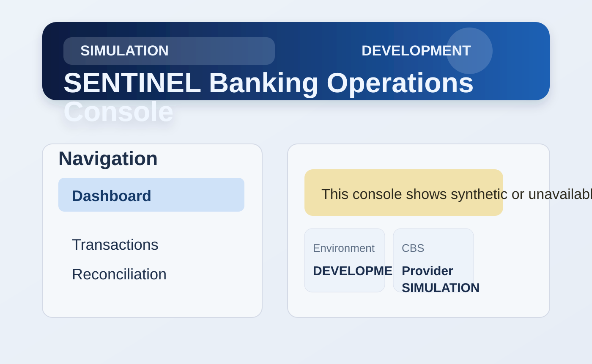

# SENTINEL

## Project purpose

SENTINEL is a Core Banking Transaction Integrity & Anomaly Sentinel. It is a transaction-control and anomaly-control plane designed to operate around an existing Core Banking System (CBS). Its purpose is to protect distributed financial workflows from duplicate requests, replay, timeout uncertainty, partial posting, inconsistent balances, reconciliation exceptions, and system-wide anomalies.

The CBS remains the authoritative financial source of truth. SENTINEL does not implement or represent a competing financial ledger.

## Safe operating model

The released v1.0.0 baseline remains frozen. This repository is intentionally structured to keep the authoritative CBS outside the SENTINEL domain boundary.

The supported operating modes are:

- SIMULATION: deterministic validation scenarios only
- PLACEHOLDER: synthetic non-authoritative CBS adapter for integration testing
- BANK_SANDBOX / BANK_STAGING / BANK_PRODUCTION: future approved bank-specific modes only

SENTINEL must never silently downgrade from a real production mode to simulation or placeholder logic.

## Current implementation status

This repository includes:

- a canonical CBS adapter port and data contracts
- a deterministic simulator adapter for scenario-driven testing
- a placeholder CBS adapter that follows the same contract
- a FastAPI simulation console and banking operations UI
- orchestration logic that preserves UNKNOWN, reconciliation, and duplicate protection semantics

The simulator and placeholder adapter are explicitly non-authoritative and clearly labeled as synthetic. This repository is therefore suitable for local development, demonstration, contract testing, and fault simulation. It is not a live bank connection or a deployed production payment service.

## Screenshots





This synthetic UI is for local simulation, scenario validation, and demonstration only. It does not represent a live bank, real customer data, or a production CBS connection.

## Running the local simulation console

```powershell
cd D:\Projects\cbs_sentinel\SENTINEL
.\.venv\Scripts\python.exe -m uvicorn sentinel.application.simulation_server:app --app-dir src --host 127.0.0.1 --port 8000
```

Then open:

- http://127.0.0.1:8000/
- http://127.0.0.1:8000/simulation-ui

The health endpoint is:

```powershell
Invoke-RestMethod http://127.0.0.1:8000/api/v1/simulator/health
```

## Placeholder CBS mode

The placeholder adapter is intentionally safe for engineering validation, not a bank ledger. It implements the same adapter contract as the future real bank integration and uses example/synthetic credentials only.

```powershell
$env:SENTINEL_ENVIRONMENT = "development"
$env:SENTINEL_CBS_PROVIDER = "placeholder"
Remove-Item Env:SENTINEL_CBS_ENDPOINT -ErrorAction SilentlyContinue
```

The placeholder environment is for:

- adapter contract validation
- UI workflow testing
- orchestration and reconciliation semantics
- duplicate protection checks

It is not a production connection and is never authoritative.

Endpoint configuration alone cannot activate real-bank connectivity. A real bank
connection requires an explicitly implemented and approved bank-specific adapter;
simulation and placeholder modes are synthetic and non-authoritative.

## Environment configuration

See `.env.example` for safe local defaults. In production, the system requires external secret management, HSM-backed key material, and an external IAM provider.

## Architecture

```text
Banking UI / Bank Channels
        |
        v
SENTINEL API
        |
        v
Transaction Orchestrator
        |
        v
CBSAdapter port
        |
        +-------------------+
        |                   |
        v                   v
Simulator / Placeholder   Future approved bank adapter
        |                   |
        v                   v
Synthetic CBS          Real CBS / authoritative ledger
```

The UI and domain layers never talk directly to PostgreSQL, Redis, Kafka, or the bank ledger. All financial actions pass through the application and adapter boundary.

## Future real-bank integration

A future real-bank adapter must implement the same canonical contract defined in `src/sentinel/adapters/cbs/port.py` and `src/sentinel/adapters/cbs/contracts.py`.

The bank-specific adapter handles:

- protocol translation and authentication
- request/response mapping
- timeout and duplicate handling
- reversal and reconciliation semantics
- status mapping while preserving SENTINEL’s domain model

Bank integration documentation is in `docs/integration/`.

## Security warnings

- Never commit production credentials or bank secrets.
- Never use simulator tokens or synthetic values in a production deployment.
- Never assume a timeout or lost response means a transaction succeeded.
- Never allow a placeholder or simulation mode to silently become production.
- Unknown and reconciliation states are first-class safety states.

## Validation

The PostgreSQL integration tests require a reachable local test database. Configure a database URL before running the complete suite:

```powershell
$env:SENTINEL_DATABASE_URL = "postgresql+asyncpg://sentinel_user:<password>@127.0.0.1:5432/sentinel"
.\.venv\Scripts\python.exe -m pytest -q
```

Other validation commands:

```powershell
.\.venv\Scripts\python.exe -m ruff check .
.\.venv\Scripts\python.exe -m mypy src
.\.venv\Scripts\python.exe -m compileall -q src tests
git diff --check
```

Current repository validation: **203 tests passed**. Individual timing values vary by machine and database configuration.

## Limitations

- The simulator and placeholder CBS implementations are non-authoritative.
- No real bank, CBS vendor, payment switch, or settlement system is connected.
- The UI uses synthetic accounts and scenarios.
- Production performance and latency have not been established through a bank-grade benchmark.
- Kafka, Redis, and PostgreSQL integrations are represented by contracts or local integration tests; no live bank deployment is claimed.
- External IAM, approved mTLS certificates, secrets/KMS, and bank-specific adapters are required before real deployment.
- Security and performance claims require institution-specific testing before production acceptance.

This repository is intended to remain distinct from the frozen v1.0.0 release boundary while production-style placeholder and adapter architecture evolves on the feature branch.
